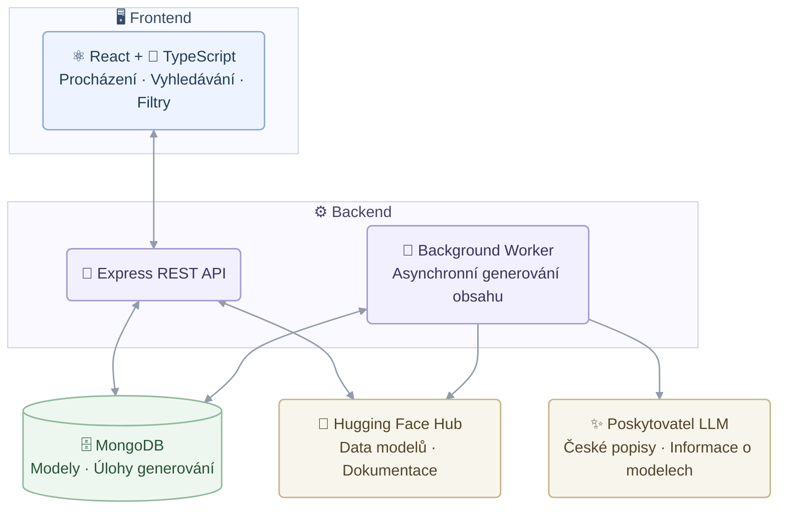

<a name="ai-model-explorer"></a>

**CZ** | [EN](README.en.md)

**Webová aplikace, která usnadňuje pochopení AI modelů z Hugging Face.**

Aplikace je určená pro každého – od zvědavých začátečníků bez znalostí strojového učení až po zkušenější uživatele, kteří hledají technické podrobnosti. Poskytuje srozumitelná česká vysvětlení jednotlivých modelů, ale také technické údaje o jejich možnostech, architektuře, kompatibilitě a požadavcích na nasazení.

**[Otevřít aplikaci →](https://ai-model-explorer.netlify.app/)**

Jedná se o full-stack aplikaci, ne jen o zobrazení statického seznamu modelů: frontend je jednostránková aplikace v Reactu a TypeScriptu, backend tvoří Express API, MongoDB ukládá data modelů i vygenerovaný obsah a úlohy pro generování českých textů zpracovává fronta uložená v databázi, která využívá LLM poskytovatele kompatibilního s OpenAI API.

     

### Procházení modelů


Hlavní stránka: vyhledávací pole v horní liště, panel filtrů vlevo (úloha, jazyk, knihovna a další kategorie), záložky a nabídka řazení pro zobrazení výsledků modelů s náhledem českého popisu, štítky úloh, počtem parametrů, knihovnou, licencí, jazyky, datem poslední aktualizace, počtem stažení a lajků.

### Detail modelu


Stránka s detailem modelu: hlavička s avatarem autora, názvem modelu, statistikami a štítky podporovaných typů dat, nejvhodnější způsoby využití a celý český popis doplněný o vygenerované informace. Vedle nich je panel s technickými údaji (úloha, vstup, počet parametrů, kontext, verze, knihovna, licence a poslední aktualizace), informace o původu modelu a jeho variantách i doporučené nastavení pro nasazení.

## Obsah

- [AI Model Explorer](#ai-model-explorer)
  - [Procházení modelů](#procházení-modelů)
  - [Detail modelu](#detail-modelu)
- [Obsah](#obsah)
- [Funkce](#funkce)
- [Použité technologie](#použité-technologie)
- [Architektura](#architektura)
- [Nasazení](#nasazení)
- [Vybrané pull requesty](#vybrané-pull-requesty)
- [Technická řešení](#technická-řešení)
- [Spuštění projektu](#spuštění-projektu)
- [Proměnné prostředí](#proměnné-prostředí)
- [Testování a kvalita](#testování-a-kvalita)
- [Zatím neimplementováno](#zatím-neimplementováno)
- [Autor](#autor)

## Funkce

- **České popisy generované z dat dokumentace Hugging Face** – Česká vysvětlení toho, k čemu jednotlivé modely slouží a pro jaké praktické použití se hodí.
- **Informace o modelech** – Přehled možností, omezení, případů použití a hardwarových požadavků získaných z dokumentace modelů.
- **Vyhledávání a filtrování** – Vyhledávání podle názvu modelu, autora nebo štítků. Filtrování podle úlohy, jazyka, knihovny, licence a velikosti modelu. Řazení podle popularity, počtu stažení, lajků nebo data.
- **Přehled modelů podle kategorií** – Procházení všech modelů, doporučených, nových, trendujících, lokálních a serverových modelů.
- **Detail modelu** – Vygenerovaný český popis, doplňující informace o modelu, podporované typy dat a obrázky nebo videa dostupné z dokumentace modelu.
- **Stránkování a cachování** – Modely se načítají postupně a výsledky se ukládají do cache, což pomáhá zrychlit aplikaci a omezuje počet požadavků na server.

## Použité technologie

| Kategorie | Technologie |
| --- | --- |
| Frontend | React 18, TypeScript (strict mode), Vite, React Router 6, Fuse.js, CSS s globálními vlastními vlastnostmi a samostatným souborem pro každou komponentu |
| Backend | Node.js, Express 4, Mongoose 7, CORS, dotenv |
| Databáze | MongoDB, kolekce `models` a `generationjobs` |
| Externí služby | Hugging Face Hub API pro načítání informací o modelech a jejich vlastnostech. Pro generování popisů lze použít libovolného poskytovatele kompatibilního s OpenAI API, například Groq (výchozí), Gemini, OpenRouter, Mistral nebo lokální instanci Ollama. |
| Nástroje a CI | npm, nodemon, GitHub Actions |
| Nasazení | Netlify pro frontend, Render pro API a databázová služba MongoDB |

## Architektura



**Frontend:** Aplikace postavená na Reactu a TypeScriptu umožňuje vyhledávat, filtrovat a procházet AI modely včetně jejich detailů. S backendem komunikuje prostřednictvím REST API.

**Backend:** Express API načítá data modelů z Hugging Face a ukládá je do MongoDB. Zároveň zpracovává požadavky frontendu a vrací informace o modelech včetně dostupných vygenerovaných popisů a dalších informací.

**Background Worker:** Pokud modelu chybí popis nebo další informace, API zařadí úlohu do fronty v MongoDB, takže neblokuje zpracování dalších požadavků. Background Worker úlohu zpracuje, načte potřebnou dokumentaci modelu z Hugging Face a předá ji poskytovateli LLM, který vygeneruje český popis a další informace.

**Databáze:** MongoDB ukládá informace o modelech, vygenerovaný obsah a čekající úlohy. Vygenerované popisy a další informace se ukládají a používají i při dalších požadavcích, takže není nutné zbytečně znovu volat poskytovatele LLM.

## Nasazení

Nasazení aplikace se konfiguruje přímo ve webových rozhraních jednotlivých hostingových služeb.

### Frontend — Netlify

**Živá aplikace:** [ai-model-explorer.netlify.app](https://ai-model-explorer.netlify.app/)

- Soubor `_redirects` umožňuje přímý přístup k frontendovým cestám, například `/model/<id>`, a to i po obnovení stránky.
- Netlify sestavuje frontend přes integraci s Gitem. Při buildu se také určuje verze aplikace zobrazovaná v záhlaví.
- `npm run build` vytvoří statické soubory ve složce `dist/`.

### Backend — Render

**API:** [ai-modely-api.onrender.com](https://ai-modely-api.onrender.com)

- API se při spuštění nastaví podle proměnné PORT a naslouchá na adrese 0.0.0.0
- API využívá bezplatný tarif Renderu, ve kterém se při delší neaktivitě služba automaticky uspí. První požadavek pak následně může trvat i několik desítek sekund.
- Aby se těmto prodlevám předešlo, volá úloha na cron-job.org každých 10 minut endpoint GET /health, který ověřuje dostupnost API bez připojování k MongoDB nebo Hugging Face. 
- API při spuštění načte nejoblíbenější modely do paměti, což urychluje zobrazení výsledků při prvním načtení stránky.

## Vybrané pull requesty

Odkazy vedou na jednotlivé pull requesty, kde jsou vidět provedené změny i související komentář.

- **[#46 – Optimalizace generování obsahu AI modelů](https://github.com/petravrob/ai-model-explorer/pull/45)** – Generování se přesunulo z průběhu API požadavku do fronty uložené v databázi. Fronta podporuje priority, prevenci duplicit, opakování při chybě, prodlevy při dosažení limitu požadavků a zpracování více modelů současně. Přidány byly také skripty pro předběžné generování chybějících a zastarelých popisů.
- **[#36 – Vylepšení generování popisů modelů pomocí AI](https://github.com/petravrob/ai-model-explorer/pull/35)** – Prompt pro generování byl upraven a bylo přidáno verzování, aby bylo možné starší texty správně aktualizovat. Krátké shrnutí nahradil rozsáhlejší popis, který lépe vysvětluje, k čemu model slouží a jak funguje.
- **[#30 – Přidání lišty se záložkami](https://github.com/petravrob/ai-model-explorer/pull/29)** – Vytvořena podpora pro různé způsoby zobrazení seznamu modelů (Vše, Doporučené, Nové, Trendující, Lokální běh, Na serveru).
- **[#28 – Generování obsahu z dokumentace modelů pomocí AI a oprava denního limitu poskytovatele](https://github.com/petravrob/ai-model-explorer/pull/26)** – Přidány strukturované informace získávané z dokumentace modelů  a zavedena podpora více poskytovatelů pro generování obsahu. Při vyčerpání denního limitu jednoho poskytovatele se automaticky přejde na dalšího.
- **[#26 – Úprava karty modelu](https://github.com/petravrob/ai-model-explorer/pull/25)** – Karty modelů byly doplněny o další údaje, nyní zobraují úvodní popis, úlohu modelu, počet parametrů, knihovnu, licenci, jazyky a datum poslední aktualizace.
- **[#23 – Přidání nabídky řazení AI modelů](https://github.com/petravrob/ai-model-explorer/pull/22)** – Umožňuje zobrazit výsledky podle popularity, počtu stažení, lajků a data vytvoření. Zvolené řazení zůstává uložené v URL a zachová se i při přechodu mezi seznamem a detailem modelu.
- **[#21 – Oprava a vylepšení vyhledávání pomocí fuzzy search](https://github.com/petravrob/ai-model-explorer/pull/20)** – Upraveno vyhledávací pole a přidáno  vyhledávání pomocí knihovny Fuse.js. I když vyhledávané slovo nemá přesnou shodu, zobrazí se nejbližší odpovídající modely.
- **[#19 – Načítání skutečných dat AI modelů z Hugging Face](https://github.com/petravrob/ai-model-explorer/pull/18)** – Pevně zadané testovací data byly nahrazeny daty skutečných modelů z Hugging Face. Byla přidána podpora Hugging Face API a skript pro import modelů do databáze. Upraveno také zobrazování dat v seznamu a detailu modelu.

## Technická řešení

### Fronta pro asynchronní generování

Generování pomocí AI probíhá nezávisle na API požadavcích. Úlohy se ukládají do MongoDB, což pomáhá předcházet duplicitám a zachovává je i po restartu serveru. Modely, které uživatel právě prohlíží mají vyšší prioritu, aby se načetli rychleji. Popisy se generují po skupinách, aby se snížil počet požadavků na LLM. Velikost skupiny se přizpůsobuje prioritě úloh, aby se popisy právě prohlížených modelů vygenerovaly co nejdříve.

### Zpracování chyb a přepínání poskytovatelů

Chyby se zpracovávají podle jejich typu. Selhání, u kterých má smysl požadavek opakovat se zkoušejí znovu, jiné se přeskočí. Pokud poskytovatel dosáhne limitu požadavků nebo je nedostupný, fronta se pozastaví. Systém podporuje více poskytovatelů LLM a při výpadku jednoho automaticky přepne na jiného a pokračuje ve zpracování požadavků.

### Ukládání dat a cachování

Data modelů, popisy a další informace se ukládají do MongoDB. Při aktualizaci dat se vygenerovaný obsah zachovává a znovu se generuje pouze tehdy, když se změní verze zadání promptu nebo zdrojová dokumentace. Odpovědi Hugging Face i výsledky ve frontendu se ukládají do cache, aby se omezily opakované požadavky a zvýšila se rychlost aplikace.

### Napojení na Hugging Face

Seznam modelů se načítá postupně po jednotlivých stránkách, takže není nutné stahovat všechna data najednou. Informace o modelech a avataři se ukládají do cache, aby se omezilo jejich opakované načítání. Požadavky mají nastavené časové limity a opakování, což pomáhá zvládat omezení API.

### Stav frontendu a výkon

Vyhledávání, řazení, záložky a filtry jsou synchronizované s URL, takže lze konkrétní nastavení sdílet nebo obnovit. Debouncing, rušení požadavků a cachování omezují zbytečná volání API. Stav seznamu modelů se navíc ukládá do session storage, aby zůstal zachovaný při přecházení z detailu modelu.

### Indexy databáze

MongoDB využívá indexování, které urychluje vyhledávání modelů podle zvolených filtrů a řazení. API tak může načíst požadované modely, aniž by muselo procházet všechny záznamy.
## Spuštění projektu

Repozitář obsahuje dva samostatné projekty. Pro spuštění je potřeba nainstalovat závislosti a každý projekt spustit v samostatném terminálu:

- `ai-modely/` — frontend v Reactu a TypeScriptu
- `ai-modely-node/` — Express API, modely MongoDB a background worker

**Příprava a spuštění projektu:**

1. [Požadavky](#požadavky)
2. [Klonování repozitáře](#2-klonování-repozitáře)
3. [Nastavení backendu](#3-nastavení-backendu)
4. [Nastavení frontendu](#4-nastavení-frontendu)
5. [Generování českých popisů a dalších informací (volitelné)](#5-generování-českých-popisů-a-dalších-informací-volitelné)
6. [Sestavení frontendu](#6-sestavení-frontendu)

### Požadavky

- **Node.js 24 a npm**
- **MongoDB** — lokální server nebo hostovaná databáze
- **API klíč pro LLM (volitelný)** — potřebný pro generování českých popisů a dalších informací
- **Hugging Face token (volitelný)** — umožňuje využívat vyšší limity API

### 1. Klonování repozitáře

```bash
git clone https://github.com/petravrob/ai-model-explorer.git
cd ai-model-explorer
```

### 2. Nastavení backendu

V prvním terminálu:

```bash
cd ai-modely-node
npm install
cp .env.example .env
```

V systému Windows lze místo příkazu `cp .env.example .env` použít `copy .env.example .env`.

V souboru `.env` je potřeba nastavit hodnoty `MONGO_URI` a `JWT_SECRET`. Proměnná `MONGO_URI` musí obsahovat také název databáze.

Databázi lze inicializovat a API spustit pomocí následujících příkazů:

```bash
npm run create:indexes
npm run import:models
npm run dev
```

- `create:indexes` vytvoří potřebné databázové indexy. Pro každou databázi stačí příkaz spustit jednou.
- `import:models` naimportuje oblíbené modely z Hugging Face a načte také avatary autorů.
- `npm run dev` spustí API s automatickým restartováním při změnách. Pro spuštění bez automatického restartování slouží příkaz `npm start`.

API standardně naslouchá na portu `5000`. Další možnosti konfigurace jsou uvedeny v části [Proměnné prostředí](#proměnné-prostředí).

### 3. Nastavení frontendu

Ve druhém terminálu:

```bash
cd ai-modely
npm install
npm run dev
```

Vite vypíše lokální URL adresu do terminálu.

Ve výchozím nastavení frontend používá nasazené API. Pro použití lokálního backendu je potřeba vytvořit soubor `ai-modely/.env` s následujícím obsahem:

```env
VITE_API_URL=development
```

### 4. Generování českých popisů a dalších informací (volitelné)

Aplikace generuje chybějící obsah automaticky při prohlížení modelů. Obsah lze vygenerovat také předem pomocí následujících skriptů:

```bash
cd ai-modely-node

npm run prewarm:descriptions -- --limit=100
npm run prewarm:recent
npm run generate:content
```

- `prewarm:descriptions` připraví popisy pro 100 modelů s nejvyšším počtem stažení.
- `prewarm:recent` připraví popisy pro modely aktualizované během posledních sedmi dnů.
- `generate:content` zpracovává všechny modely, kterým chybí popisy nebo další informace, dokud není fronta prázdná.

Skripty podporují také další možnosti, například výběr konkrétních modelů nebo úloh a omezení počtu modelů. Rychlost generování závisí na dostupném limitu zvoleného poskytovatele. Nedokončené úlohy zůstávají ve frontě a lze je zpracovat později.

**Před spuštěním těchto skriptů je nutné ověřit, že `MONGO_URI` odkazuje na správnou databázi.** Skripty do ní zapisují přímo. Opakované spuštění je bezpečné, protože již existující aktuální obsah se přeskočí.

### 5. Sestavení frontendu

```bash
cd ai-modely
npm run build
npm run preview
```

Produkční build se vytvoří ve složce `dist/`. Příkaz `preview` jej lokálně zpřístupní pro kontrolu.

## Proměnné prostředí (Enviroment Variables)

### Backend — `ai-modely-node/.env`

Soubor `.env.example` obsahuje seznam dostupných proměnných a příklady konfigurace. Skutečné hodnoty je potřeba ukládat do souboru `.env`, který Git ignoruje.

| Proměnná | Účel | Povinná |
| --- | --- | --- |
| `MONGO_URI` | Připojovací řetězec k MongoDB včetně názvu databáze | Ano |
| `JWT_SECRET` | Tajný klíč vyžadovaný konfigurací backendu | Ano |
| `PORT` | Port API, výchozí hodnota je `5000` | Ne |
| `HUGGINGFACE_API_KEY` | Hugging Face token pro vyšší limity API | Ne |
| `SUMMARY_API_KEY` | API klíč poskytovatele LLM | Pro generování |
| `SUMMARY_API_URL` | URL API poskytovatele | Pro generování |
| `SUMMARY_MODEL` | Název modelu používaného poskytovatelem | Pro generování |
| `SUMMARY_REASONING_EFFORT` | Volitelné nastavení intenzity uvažování pro podporované modely | Ne |
| `GENERATION_CONCURRENCY` | Počet současně zpracovávaných úloh, výchozí hodnota je `4` | Ne |

Lze nastavit až pět poskytovatelů pomocí očíslovaných variant, například `SUMMARY_API_KEY_2`, `SUMMARY_API_URL_2` a `SUMMARY_MODEL_2`. Poskytovatelé se zkoušejí v daném pořadí, takže při vyčerpání limitu nebo nedostupnosti jednoho z nich může systém přejít na dalšího.

API používá rozhraní kompatibilní s OpenAI. Podporováni jsou například Groq, Gemini, OpenRouter, Mistral a lokální instance Ollama. Pro prvního poskytovatele lze použít také `GROQ_API_KEY`.

Bez API klíče pro LLM aplikace funguje, ale české popisy a další informace se negenerují.

### Frontend — `ai-modely/.env`

| Proměnná | Účel | Výchozí hodnota |
| --- | --- | --- |
| `VITE_API_URL` | Nastavením na `development` se použije `http://localhost:5000` | Používá nasazené API |

Soubor `.env` pro frontend je volitelný.

## Testování a kvalita

Repozitář momentálně neobsahuje automatizované testy.

[CI workflow](.github/workflows/ci.yml) se spouští při každém pushi a pull requestu a používá Node.js 24.

| Projekt | Automatické kontroly |
| --- | --- |
| Frontend | `npm ci` kontrola typů TypeScriptu a produkční build |
| Backend | `npm ci` kontrola syntaxe JavaScriptu |

Kontroly frontendu lze spustit lokálně:

```bash
cd ai-modely

npm run typecheck
npm run build
```

Backend lze lokálně spustit příkazem `npm run dev` nebo `npm start` ve složce `ai-modely-node/`.

Kontrola typů frontendu a produkční build byly prověřeny na Node.js 24.19.0 a npm 11.17.0. Backend v současnosti nemá samostatný krok pro kontrolu kvality kódu ani typů.


## Autor

**Petra Vrobelová** — [github.com/petravrob](https://github.com/petravrob)

> 💼 **Právě hledám další pracovní příležitost v oblasti vývoje softwaru.**
>
> Pokud se vám projekt líbí, ozvěte se mi!