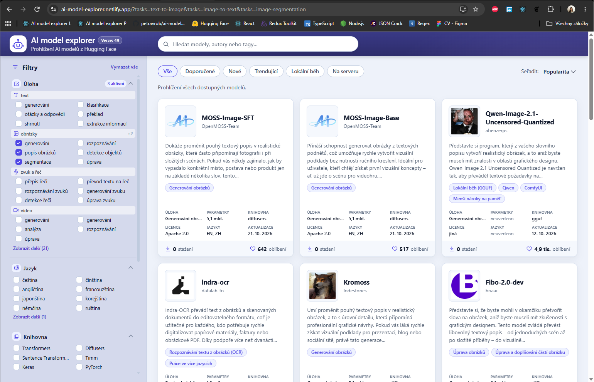
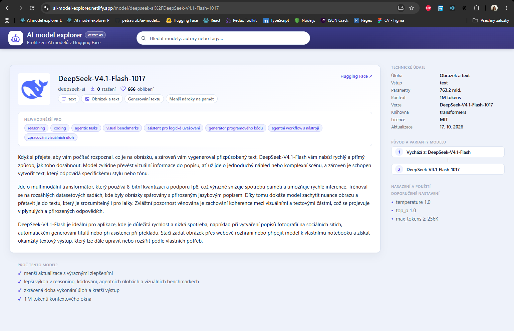
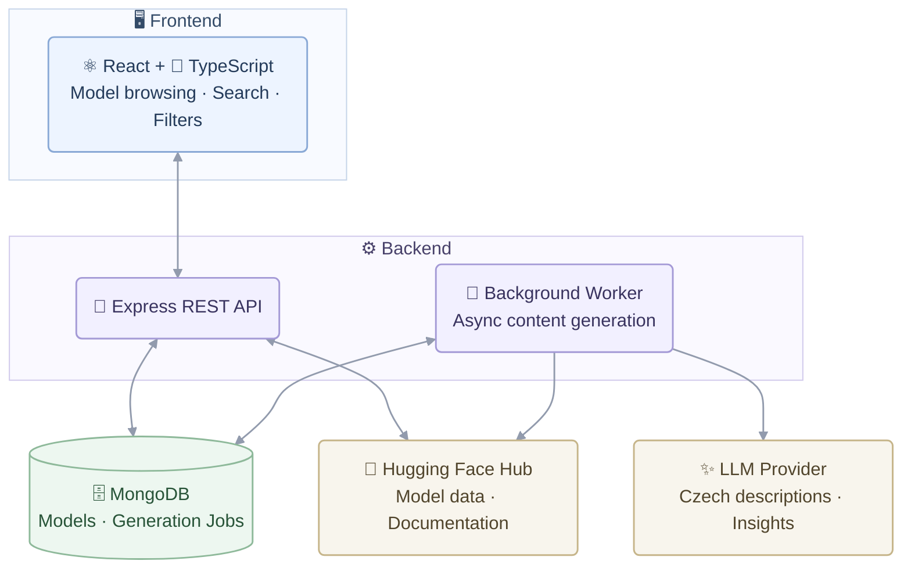

# AI Model Explorer

**A web application for exploring AI models from Hugging Face, featuring AI-generated Czech overviews that make it easier to discover and compare models.**

Designed for everyone, from curious beginners without a machine-learning background to experienced users looking for technical details. It combines accessible explanations with insights into model capabilities, architecture, compatibility and deployment requirements.

**[Open the live application →](https://ai-model-explorer.netlify.app/)**

The project is a full-stack application, not a static listing: a React and TypeScript single-page app, an Express API, MongoDB for model data and generated content, and a database-backed background queue that calls an OpenAI-compatible LLM provider to produce the Czech text.

     


### Model browser



The main page: the search field in the header, the filter panel on the left (task, language, library and further categories), the tab bar and the sorting menu above the results, and model cards with the Czech description preview, task tags, parameters, library, licence, languages, last update, downloads and likes.

### Model detail



A model detail page: the header with the author avatar, the model name, the statistics, the modality badges, the best use-cases and the full Czech description alongside with the generated insight sections, next to the technical sidebar (task, input, parameters, context, version, library, licence, last update), the model's origin and variants, and the recommended deployment settings.


## Table of contents

- [AI Model Explorer](#ai-model-explorer)
  - [Model browser](#model-browser)
  - [Model detail](#model-detail)
- [Table of contents](#table-of-contents)
- [Features](#features)
- [Tech stack](#tech-stack)
- [Architecture](#architecture)
- [Deployment](#deployment)
- [Selected pull requests](#selected-pull-requests)
- [Engineering Highlights](#engineering-highlights)
- [Getting Started](#getting-started)
- [Environment Variables](#environment-variables)
- [Testing and Quality](#testing-and-quality)
- [Not implemented yet](#not-implemented-yet)
- [Author](#author)

## Features

- **AI-Generated Czech Descriptions** – Read Czech descriptions explaining each model's purpose and practical applications.
- **Model Insights** – Explore use cases, capabilities, limitations and hardware requirements extracted from model documentation.
- **Search and Filtering** – Search by model name, author or tags, filter by task, language, library, licence and model size, and sort results by popularity, downloads, likes or date.
- **Six Model Views** – Browse All, Recommended, New, Trending, Local and Server models.
- **Model Details** – View technical metadata, generated insights, supported modalities and available images or videos from model documentation.
- **Pagination and Caching** – Load model data incrementally and cache results to reduce repeated requests and improve browsing performance.

## Tech stack

| Category | Stack |
| --- | --- |
| Frontend | React 18, TypeScript (strict mode), Vite, React Router 6, Fuse.js, plain CSS with global custom properties and one stylesheet per component |
| Backend | Node.js, Express 4, Mongoose 7, CORS, dotenv |
| Database | MongoDB, with the `models` and `generationjobs` collections |
| External services | Hugging Face Hub API (model lists, model details, model cards, author avatars) and any OpenAI-compatible chat completions provider (Groq by default; Gemini, OpenRouter, Mistral or a local Ollama instance also work) |
| Tooling and CI | npm, nodemon, GitHub Actions |
| Deployment | Netlify for the frontend, Render for the API, a hosted MongoDB database |

## Architecture



**Frontend:** The React and TypeScript frontend displays AI models and allows users to search, filter and explore their details. It communicates with the backend through the REST API.

**Backend:** The Express API fetches model data from Hugging Face and stores it in MongoDB. It also handles requests from the frontend and returns model information together with any generated descriptions and insights already available.

**Background Worker:** When a model is missing a description or insights, the API adds a job to the MongoDB queue and returns without waiting for the AI response. The background worker processes these jobs, retrieves the necessary model documentation from Hugging Face and sends it to the LLM provider to generate Czech descriptions and insights.

**Database:** MongoDB stores model information, generated content and pending jobs. Once generated, descriptions and insights are saved and reused for future requests, avoiding unnecessary calls to LLM provider.
## Deployment

Deployment is configured through the hosting dashboards.

### Frontend — Netlify

**Live app:** [ai-model-explorer.netlify.app](https://ai-model-explorer.netlify.app/)

- The `_redirects` file enables direct access to frontend routes such as `/model/<id>`, including after refreshing the page.
- Netlify builds the frontend using its Git integration. The build also determines the application version displayed in the header.
- `npm run build` generates the static files in `dist/`.

### Backend — Render

**API:** [ai-modely-api.onrender.com](https://ai-modely-api.onrender.com)

- The API uses the `PORT` environment variable and binds to `0.0.0.0`.
- `GET /health` responds without querying MongoDB or Hugging Face and is used as a keep-alive endpoint. A cron-job.org job pings it every 10 minutes.
- The free Render instance can sleep after inactivity, causing delays of tens of seconds on the first request. Keep-alive pings reduce these cold starts but cannot eliminate them entirely.
- On startup, the API preloads the most popular model list into memory to reduce the initial loading time for visitors.

## Selected pull requests

Each of these is a merged pull request in the repository; the links point at the change and the discussion, not just at the resulting code.

- **[#46 - Optimized the AI model content generation](https://github.com/petravrob/ai-model-explorer/pull/45)** - moved generation out of the request path into a database-backed queue with priorities, duplicate prevention, retries, limit rate cooldowns and batch generation, and added the bulk generation scripts.
- **[#36 - Improved the AI generation of text for model description](https://github.com/petravrob/ai-model-explorer/pull/35)** - reworked the prompt, introduced description versioning so older text can be regenerated, and replaced short summaries with longer descriptions shown in part on the card and in full on the detail page.
- **[#30 - Added new option to filter models based on tabs](https://github.com/petravrob/ai-model-explorer/pull/29)** - added the tab bar and the backend support behind it, where each tab reads a different sorted Hugging Face list so the tabs do not show the same models.
- **[#28 - Added AI generation to transform model README information and quickfixed the AI generation provider daily limit used](https://github.com/petravrob/ai-model-explorer/pull/26)** - introduced the structured insights extracted from the model documentation through a dedicated insights service and a multi-provider AI client with automatic fallback, and fixed how an exhausted daily limit at one provider is handled so it no longer blocks generation.
- **[#26 - Updated Model Card Details](https://github.com/petravrob/ai-model-explorer/pull/25)** - reworked the model card and the list around a shared model card helper, so each card shows the model's task, parameters, library, licence, languages and last update next to its generated Czech description.
- **[#23 - Added AI Models sorting dropdown](https://github.com/petravrob/ai-model-explorer/pull/22)** - added the sorting dropdown with popularity, downloads, likes and creation date, backed by the matching sort keys on the server and kept in the URL so the chosen order survives a return from a model detail page.
- **[#21 - Fixed and improved search field, fuzzy search enabled](https://github.com/petravrob/ai-model-explorer/pull/20)** - reworked the search field and added fuzzy matching with Fuse.js, so a query without an exact match still returns the closest models and the interface says the results are approximate.
- **[#19 - Displaying real AI model data from Hugging Face](https://github.com/petravrob/ai-model-explorer/pull/18)** - replaced the hard-coded seed data with real models pulled from the Hugging Face Hub, added the import script and the Hugging Face service, and updated the list and detail views to show the real data.

## Engineering Highlights

### Background Generation Queue
AI generation runs in the background without blocking API requests. Jobs are stored in MongoDB to prevent duplicates and survive server restarts. Recently requested models get higher priority, and descriptions are generated in batches to reduce the number of LLM requests.

### Error Handling and Provider Fallback
Errors are handled based on their type. Temporary failures are retried, permanent failures are skipped, and the queue pauses when a provider reaches a rate limit or is out of service. Multiple LLM providers are supported, with automatic fallback when one becomes unavailable.

### Data Storage and Caching
Model data, descriptions and insights are stored in MongoDB. Generated content is preserved during data refreshes and regenerated only when the prompt version or source documentation changes. Hugging Face responses and frontend results are cached to reduce repeated requests and improve performance.

### Hugging Face Integration
The API fetches models page by page using cursor pagination instead of loading the entire catalogue at once. Model cards and author avatars are cached, and requests use timeouts and retries to handle rate limits.

### Frontend State and Performance
Search, sorting, tabs and filters are synchronized with the URL, allowing users to share and restore specific views. Debouncing, request cancellation and caching reduce unnecessary API calls, while session storage preserves the catalogue state when navigating between model details and the catalogue.

### Database Indexes
MongoDB uses compound indexes to speed up model queries by combining fields used for sorting and filtering. This allows the API to retrieve matching models without scanning the entire collection.

## Getting Started

The repository contains two independent projects. Install dependencies and run each one in a separate terminal:

- `ai-modely/` — React and TypeScript frontend
- `ai-modely-node/` — Express API, MongoDB models and background worker

Steps in this chapter:

- [Prerequisites](#prerequisites)
- [1. Clone the repository](#1-clone-the-repository)
- [2. Set up the backend](#2-set-up-the-backend)
- [3. Set up the frontend](#3-set-up-the-frontend)
- [4. Generate Czech descriptions and insights (optional)](#4-generate-czech-descriptions-and-insights-optional)
- [5. Build the frontend](#5-build-the-frontend)

### Prerequisites

- **Node.js 24 and npm**
- **MongoDB** — a local server or hosted database
- **LLM API key (optional)** — required to generate Czech descriptions and insights
- **Hugging Face token (optional)** — increases API rate limits

### 1. Clone the repository

```bash
git clone https://github.com/petravrob/ai-model-explorer.git
cd ai-model-explorer
```

### 2. Set up the backend

In terminal 1:

```bash
cd ai-modely-node
npm install
cp .env.example .env
```

On Windows, use `copy .env.example .env` instead.

Open `.env` and set `MONGO_URI` and `JWT_SECRET`. Make sure `MONGO_URI` includes the database name.

Initialize the database and start the API:

```bash
npm run create:indexes
npm run import:models
npm run dev
```

- `create:indexes` creates the required database indexes. Run it once per database.
- `import:models` imports popular models from Hugging Face and also fetches author avatars.
- `npm run dev` starts the API with automatic reloading. Use `npm start` to run it without reloading.

The API listens on port `5000` by default. See [Environment Variables](#environment-variables) for configuration options.

### 3. Set up the frontend

In terminal 2, from the repository root:

```bash
cd ai-modely
npm install
npm run dev
```

Vite prints the local URL in the terminal.

By default, the frontend uses the deployed API. To use your local backend, create `ai-modely/.env` with:

```env
VITE_API_URL=development
```

### 4. Generate Czech descriptions and insights (optional)

The application generates missing content in the background as users browse models. You can also generate content in advance:

```bash
cd ai-modely-node

npm run prewarm:descriptions -- --limit=100
npm run prewarm:recent
npm run generate:content
```

- `prewarm:descriptions` prepares descriptions for the 100 most downloaded models.
- `prewarm:recent` prepares descriptions for models updated in the last seven days.
- `generate:content` processes all missing descriptions and insights until the queue is empty.

The scripts support additional options, including selecting specific models or tasks and limiting the number of models. Generation depends on the provider's available quota, unfinished jobs remain in the queue and can be processed later.

**Before running these scripts, check that `MONGO_URI` points to the intended database.** They write directly to it. Running them again is safe because up-to-date content is skipped.

### 5. Build the frontend

```bash
cd ai-modely
npm run build
npm run preview
```

The production build is created in `dist/`. The preview command serves it locally.

## Environment Variables

### Backend — `ai-modely-node/.env`

The `.env.example` file lists the available variables and includes example configurations. Keep actual secrets in `.env`, which is excluded from Git.

| Variable | Purpose | Required |
| --- | --- | --- |
| `MONGO_URI` | MongoDB connection string, including the database name | Yes |
| `JWT_SECRET` | Secret required by the backend configuration | Yes |
| `PORT` | API port; defaults to `5000` | No |
| `HUGGINGFACE_API_KEY` | Hugging Face token for higher rate limits | No |
| `SUMMARY_API_KEY` | API key for the LLM provider | For generation |
| `SUMMARY_API_URL` | Provider's API URL | For generation |
| `SUMMARY_MODEL` | Model name used by the provider | For generation |
| `SUMMARY_REASONING_EFFORT` | Optional reasoning effort setting for supported models | No |
| `GENERATION_CONCURRENCY` | Number of jobs processed simultaneously; defaults to `4` | No |

You can configure up to five providers using numbered variants such as `SUMMARY_API_KEY_2`, `SUMMARY_API_URL_2` and `SUMMARY_MODEL_2`. Providers are tried in order, allowing fallback when a provider reaches its quota or becomes unavailable.

The API uses an OpenAI-compatible chat completions interface. Supported options include Groq, Gemini, OpenRouter, Mistral and local Ollama instances. `GROQ_API_KEY` is also accepted for the first provider.

Without an LLM API key, the catalogue still works, but Czech descriptions and insights are not generated.

### Frontend — `ai-modely/.env`

| Variable | Purpose | Default |
| --- | --- | --- |
| `VITE_API_URL` | Set to `development` to use `http://localhost:5000` | Uses the deployed API |

The frontend `.env` file is optional.

## Testing and Quality

The repository does not currently include an automated tests.

The [CI workflow](.github/workflows/ci.yml) runs on every push and pull request using Node.js 24.

| Project | Automated checks |
| --- | --- |
| Frontend | `npm ci`, TypeScript type check and production build |
| Backend | `npm ci` and JavaScript syntax checks |

You can run the frontend checks locally:

```bash
cd ai-modely
npm run typecheck
npm run build
```

To start the backend locally, use `npm run dev` or `npm start` from `ai-modely-node/`.

The frontend type check and production build were verified on Node.js 24.19.0 with npm 11.17.0. The backend does not currently have a separate linting or type-checking step.


## Author

**Petra Vrobelová** - [github.com/petravrob](https://github.com/petravrob)

