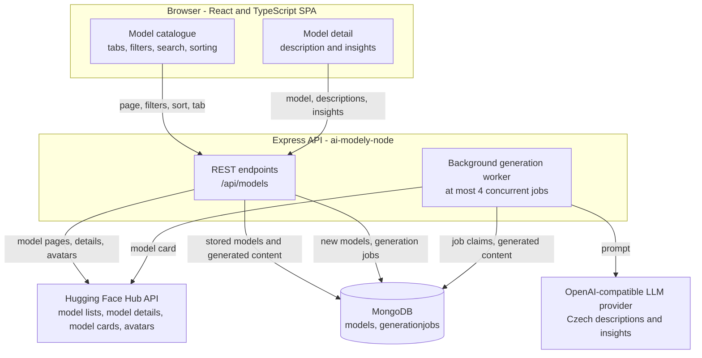

# AI Model Explorer

**A Czech-language web application for exploring AI models from Hugging Face, with AI-generated Czech descriptions that make technical model information understandable to non-experts.**

Hugging Face hosts an enormous catalogue of models, but its model pages assume that the reader is comfortable with pipeline tags, parameter counts, quantization formats and benchmark tables. AI Model Explorer is built for Czech-speaking users who are curious about AI models but are not machine-learning engineers. It browses the Hugging Face catalogue, presents each model in Czech, and adds two layers of generated content: a readable description of what the model does and who it is for, and a structured set of insights extracted from the model's own documentation (capabilities, use cases, limitations, deployment frameworks, hardware requirements, variants, images and videos). The entire interface is in Czech.

The project is a full-stack application, not a static catalogue: a React and TypeScript single-page app, an Express API, MongoDB for model data and generated content, and a database-backed background queue that calls an OpenAI-compatible LLM provider to produce the Czech text.

**[Open the live application →](https://ai-model-explorer.netlify.app/)**


## Screenshots

Screenshots are not committed to the repository yet, so the README does not reference any image files. To finish this section, capture the application and save the files into a `docs/screenshots/` folder at the repository root, then reference them with relative paths such as ``.

| Screen | What to capture | Suggested file |
| --- | --- | --- |
| Model catalogue | The main page with the tab bar, the sorting menu, the filter panel and several model cards including Czech descriptions | `docs/screenshots/catalogue.png` |
| Filtering and search | The filter panel with a few categories expanded, or a search query with its results | `docs/screenshots/filters.png` |
| Model detail | A detail page with the Czech description, the generated insight sections and the technical sidebar | `docs/screenshots/model-detail.png` |
| Mobile layout | The catalogue at phone width, with the collapsed search and the filter and sorting icons in the header | `docs/screenshots/mobile.png` |

Tip: the pull request descriptions of [#29](https://github.com/petravrob/ai-model-explorer/pull/29) and [#35](https://github.com/petravrob/ai-model-explorer/pull/35) already contain captures of the model catalogue and the detail page, taken before the most recent layout refinements.

## Features

### Browsing the Hugging Face catalogue

- The catalogue is requested from the Hugging Face Hub API one page at a time, 24 models per page. A "Load more" button appends the next page, following the cursor that Hugging Face returns in its `Link` header.
- Six tabs narrow the catalogue to a specific slice: **All**, **Recommended** (models with a licence, a library, a parameter count and at least one like), **New** (published in the last 60 days), **Trending** (positive Hugging Face trending score), **Local** (quantized formats such as GGUF, AWQ, GPTQ, ONNX, OpenVINO or MLX, or up to 1 billion parameters) and **Server** (above 13 billion parameters). Each tab reads a different sorted Hugging Face list, so the tabs do not repeat the same models.
- Sorting by popularity, number of downloads, number of likes or creation date.
- Filtering by task, language, library, licence, model size and author. Each category is a multi-select checkbox group, and the selected filters are written into the URL, so a filtered view can be shared or restored after visiting a model detail page.
- Search across model name, author, task, Hugging Face identifier and tags. Matching ignores case and diacritics; when nothing matches exactly, Fuse.js returns the closest models and the interface says that the results are approximate.

### Model cards and the model detail page

- List cards show the author avatar, a preview of the Czech description (until it exists, a short sentence derived from the model's task and tags), task tags, parameters, library, licence, languages, last update, downloads and likes.
- The detail page shows the full Czech description and the generated insight sections: highlights, best use cases, input and output modalities, context length, architecture, model family and variants, inference frameworks, recommended settings, hardware requirements, quantization formats and compatibility.
- Images and videos extracted from the model documentation are shown in a gallery, and a "how the model works" flow diagram is drawn only when the documentation actually describes the processing path.
- Every model links to its original Hugging Face page.

### AI-generated Czech content

- Descriptions are generated for the models that are actually being displayed. The client asks for descriptions in batches of up to eight missing models; the API immediately returns what is already stored and queues the rest.
- While a description is still being generated, the card shows a skeleton that reserves the same amount of space as the finished text, so the list does not jump when the text arrives. If the text does not arrive after a bounded number of attempts, the card falls back to a short sentence derived from the model's task and tags instead of waiting indefinitely.
- Generated text is stored in MongoDB, so each model is generated once and then served from the database.

### Browsing experience

- Returning from a model detail page restores the scroll position and the previously loaded number of models; changing the tab, the sorting or the filters deliberately starts the list from the top.
- On desktop the filter panel is always visible. On narrower screens the filters and the sorting menu move into panels opened from the header icons, the search field collapses behind a magnifier button, and the tab bar hides while scrolling down.
- Loading, empty and error states are handled explicitly: a logo animation while a list is loaded or refreshed, inline messages for errors and empty results, and a separate retry message when loading another page fails.

## Tech stack

| Area | Technologies |
| --- | --- |
| Frontend | React 18, TypeScript (strict mode), Vite, React Router 6, Fuse.js, plain CSS with global custom properties and one stylesheet per component |
| Backend | Node.js, Express 4, Mongoose 7, CORS, dotenv |
| Database | MongoDB, with the `models` and `generationjobs` collections |
| External services | Hugging Face Hub API (model lists, model details, model cards, author avatars) and any OpenAI-compatible chat completions provider (Groq by default; Gemini, OpenRouter, Mistral or a local Ollama instance also work) |
| Tooling and CI | npm, nodemon, GitHub Actions |
| Deployment | Netlify for the frontend, Render for the API, a hosted MongoDB database |

react-toastify is still a frontend dependency because its container is mounted in `App.tsx`, but the current application never raises a notification; the calls live in the archived authentication code.

## Architecture



**How model data enters the system.** The API never imports the whole Hugging Face catalogue. `GET /api/models` asks Hugging Face for one sorted page at a time (`sort`, `direction=-1`, `limit`, `pipeline_tag` when a task filter is active, and `expand[]` for the fields the app needs). When several tasks are selected, one page is fetched per task and the results are merged and re-sorted in memory. Language filtering cannot be pushed to Hugging Face, so with a language filter the API requests up to four times as many models (capped at 100 per request) and then narrows them down. The cursor from the `Link` header is passed to the client for the next page; `skip` is the fallback and is capped at Hugging Face's 3000-item limit.

**Where model metadata and generated content are stored.** Every model that appears in a response is written to the `models` collection if it is not stored yet, and that write uses `$setOnInsert`, so refreshing a list can never overwrite an existing document. The generated description and insights are embedded subdocuments of the model document, which is why a model has to be stored before any text can be attached to it.

**How the frontend requests and displays data.** The catalogue comes from `GET /api/models`, a single model from `GET /api/models/:modelId`, author avatars from `GET /api/models/avatar/:author`, and generated content from `POST /api/models/descriptions` (models currently on screen) and `POST /api/models/:modelId/insights` (the model that is open).

**How background generation is scheduled and processed.** No endpoint ever waits for the LLM. The two generation endpoints read whatever is already in MongoDB, enqueue the missing Hugging Face model identifiers into the `generationjobs` collection, and answer immediately. A worker inside the API process polls that collection every second, claims the highest-priority job whose `runAt` has passed, and processes at most four jobs at a time. The queue lives in the database, so it survives restarts and is shared by all server instances.

**How generated content is reused.** Because the result is stored in the model document, the next request for the same model is answered from MongoDB with no LLM call. The client polls a bounded number of times while a card shows its skeleton, so the text usually appears without a page reload. Content is regenerated only when its input changes: descriptions carry the prompt version that produced them, and insights carry a hash of the model card text they were derived from.

## Engineering highlights

### A database-backed queue for AI generation

Generation is the slowest and most failure-prone part of the system, so it is kept out of the request path. `GenerationJob` is a Mongoose model backed by the `generationjobs` collection. A unique index on `(type, modelId)` makes duplicate prevention work across instances and restarts, which a process-local `Set` could not do. Jobs are prioritised by request recency: the client re-requests the models it is displaying while they are loading, which refreshes their priority, so the text a visitor is actually waiting for is generated before older background work. Descriptions are processed in batches of six per LLM call (two for recently requested models, so the first cards fill in quickly), which keeps the number of provider requests low.

### Failure handling, retries and recovery

Every failure path is classified instead of being retried blindly. Transient provider errors are retried inside the provider client; a daily quota exhaustion skips to the next provider and pauses the whole queue for 30 minutes instead of burning the retry budget of every waiting job; an HTTP 429 pauses the queue only for the delay the provider itself reports. A job that fails for a permanent reason (for example, the model is not in the database) is not retried at all, other failures are retried up to three times with a linearly increasing delay, and the last error is stored on the job so the failure can be inspected in the database. Jobs left in `processing` by a crashed process are returned to the queue after 30 minutes. This matters because generation volume is bounded by free provider quotas, where one badly handled error can waste a whole day's budget.

### Preserving generated content instead of regenerating it

Generated Czech text is expensive to produce, so the system treats it as data that must survive everything else. Listing a model again only inserts it if it is missing (`$setOnInsert`), and the import script writes model fields with `$set` without ever touching `description` or `insights`. Both kinds of content are additionally versioned by their input: `DESCRIPTION_VERSION` invalidates descriptions written with older instructions, and insights store a SHA-256 fingerprint of the documentation excerpt, so they are regenerated only when the model card actually changes. A prompt change therefore becomes a deliberate, reviewable action rather than a silent full regeneration.

### Hugging Face integration with caching and cursor pagination

The backend depends on a single external API for everything, so repeated calls are avoided at several levels. List pages are cached in memory for 15 minutes with in-flight request de-duplication, so concurrent visitors share one Hugging Face request. Model cards are cached with an entry limit and their YAML front matter stripped, and failed card lookups are deliberately not cached. Author avatars are resolved through the dedicated Hugging Face avatar endpoint (which redirects to its CDN), cached with a longer time to live for hits than for misses, and also stored on the model documents. All Hugging Face requests share a 15-second timeout and retry with backoff when rate limited.

### MongoDB schema and indexes

A single model document holds everything known about a model: identity, statistics, Hugging Face metadata, and the generated `description` and `insights` subdocuments. Eleven compound indexes cover the ways the catalogue is sorted and filtered (downloads, likes, trending score, publication date, last modification, and task, language, tag, library, licence and author combined with downloads), and one more index supports finding models whose description still has to be generated. Indexes are created by a script instead of on startup (`autoIndex: false`), so the server does not rebuild them on every deploy.

### Frontend data flow and interaction state

The browsing state (search query, tab, sorting, filters) lives in the URL, which makes a filtered view shareable and restores it after a return from a detail page. Requests are guarded by an `AbortController` and a request identifier, so a slow response for an older filter selection cannot overwrite newer results, and filter changes are debounced by 400 ms so several checkbox clicks produce a single request. The last list for each combination of tab, sorting and filters is cached in memory, so returning from a detail page renders instantly and then refreshes silently in the background. Scroll position and the number of loaded models are kept in `sessionStorage` per history entry, and a detail page always opens at the top.

### Multiple LLM providers with automatic fallback

The text generation client accepts up to five OpenAI-compatible providers, configured as `SUMMARY_API_URL`, `SUMMARY_API_URL_2` and so on. They are tried in order, so an exhausted free-tier quota at one provider does not stop the application. A provider is skipped immediately on quota exhaustion or configuration errors, but retried on transient failures, and an API key is inherited by later providers only when they point at the same host. The outcome is summarised back to the queue, which decides whether to pause for seconds or for half an hour.

## Getting started

The repository contains two independent projects that each need their own dependencies and their own terminal session:

- `ai-modely/` - the React and TypeScript frontend
- `ai-modely-node/` - the Express API, MongoDB models, background queue and maintenance scripts

### Prerequisites

- **Node.js 24 and npm.** The CI workflow builds and checks the project on Node.js 24, and the frontend type check and build documented below were verified on Node.js 24.19.0 with npm 11.17.0.
- **A MongoDB database.** Either a hosted cluster or a local server. The connection string must include the database name, otherwise the data is written to the default `test` database.
- **Optional: an OpenAI-compatible API key.** Without it the application still runs, but no Czech descriptions or insights are generated.
- **Optional: a Hugging Face token.** Public model data works without one; a token only raises the API rate limits.

### 1. Clone the repository

```bash
git clone https://github.com/petravrob/ai-model-explorer.git
cd ai-model-explorer
```

### 2. Backend (terminal 1)

```bash
cd ai-modely-node
npm install
cp .env.example .env     # on Windows: copy .env.example .env
```

Fill in `MONGO_URI` and `JWT_SECRET` in the new `.env` file. The full list of variables is in the [environment variables](#environment-variables) section.

```bash
npm run create:indexes   # creates the collections and their indexes (once, on a fresh database)
npm run import:models    # fills the catalogue from Hugging Face
npm run dev              # nodemon; npm start runs the server without reloading
```

- `npm run create:indexes` is required only once per database. The server starts with automatic index creation disabled, so indexes are never rebuilt during a deploy.
- `npm run import:models` reads the most downloaded models for the tasks listed in `services/huggingFaceService.js` (40 per task by default) and resolves the avatar of every new author with a 200 ms pause between requests, so this is the slowest setup step. Optional flags: `--per-task=100`, `--task=text-to-image` (repeatable), `--id=<hugging-face-model-id>` (repeatable).
- If no generation key is set, the server logs that text completion is disabled and the queue is not started; the catalogue still works, only the Czech descriptions and insights are missing.
- The API listens on port 5000 by default and binds to `0.0.0.0`, which is what hosted environments expect.

### 3. Frontend (terminal 2)

```bash
cd ai-modely
npm install
npm run dev
```

Vite prints the local URL in the terminal. To point the frontend at the local API instead of the deployed one, create `ai-modely/.env` with:

```
VITE_API_URL=development
```

Without that file the frontend calls the deployed API, so the frontend can be started on its own.

### 4. Generating Czech content (optional, long-running)

The server generates descriptions and insights in the background as models are browsed. The same work can be prepared in advance, which makes the first visit faster:

```bash
cd ai-modely-node
npm run prewarm:descriptions -- --limit=100   # descriptions for the 100 most downloaded models
npm run prewarm:recent                        # descriptions for models updated in the last 7 days
npm run generate:content                      # all missing descriptions and insights, runs until the queue is empty
```

`prewarm:descriptions` accepts `--limit=N`, `--all`, `--sort=downloads|likes|created|trending|updated`, `--updated-days=N`, `--from-api=<url>`, `--dry-run` and `--timeout=<minutes>`. With `--from-api` it selects exactly the models that the running application returns first.

Two things are worth knowing before running these scripts:

- They write to the database in `MONGO_URI`, so check that `.env` points at the intended database before running them against a deployed environment.
- Generation is bounded by the provider's daily quota. Both scripts report their progress and leave unfinished jobs in the queue, so a later run or the running server can finish them. Running them again is safe: content that is already current is skipped.

### 5. Production build of the frontend

```bash
cd ai-modely
npm run build      # output in dist/
npm run preview    # serves the built output locally
```

## Environment variables

### Backend (`ai-modely-node/.env`)

`ai-modely-node/.env.example` lists these variables with explanations in Czech and is safe to commit; real values belong only in `ai-modely-node/.env`, which is git-ignored.

| Variable | Purpose | Required | Default or example |
| --- | --- | --- | --- |
| `MONGO_URI` | MongoDB connection string, including the database name (for example `mongodb+srv://<user>:<password>@<cluster>/ai-model-explorer`) | Yes | none - the server refuses to start without it |
| `JWT_SECRET` | Secret used to sign authentication tokens. It is required by `config/env.js` even though the authentication code that uses it is currently archived | Yes | none - the server refuses to start without it |
| `PORT` | Port the API listens on | No | `5000` |
| `HUGGINGFACE_API_KEY` | Hugging Face token, which raises the API rate limits | No | empty; public model data is available without a token |
| `SUMMARY_API_KEY`, `SUMMARY_API_KEY_2` … `_5` | API key of an OpenAI-compatible text generation provider | No | empty. Required for Czech descriptions and insights; `GROQ_API_KEY` is also accepted for the first provider |
| `SUMMARY_API_URL`, `SUMMARY_API_URL_2` … `_5` | Base URL of the provider | No | `https://api.groq.com/openai/v1` |
| `SUMMARY_MODEL`, `SUMMARY_MODEL_2` … `_5` | Model name at that provider | No | `openai/gpt-oss-120b` |
| `SUMMARY_REASONING_EFFORT`, `…_2` … `_5` | `reasoning_effort` sent to reasoning models; providers that do not know the parameter must leave it unset | No | empty |
| `GENERATION_CONCURRENCY` | How many generation jobs the worker processes at the same time | No | `4` |

The provider settings can be repeated up to five times (`_2`, `_3`, …) and are tried in order, so a fallback provider keeps the application running when one free tier runs out of quota. Any service with an OpenAI-compatible chat completions endpoint works, including Gemini, OpenRouter, Mistral or a local Ollama instance; the comments in `.env.example` list ready-to-use combinations.

### Frontend (`ai-modely/.env`)

The frontend has no `.env.example` file, and `.env` is git-ignored.

| Variable | Purpose | Required | Default or example |
| --- | --- | --- | --- |
| `VITE_API_URL` | Set to `development` to send requests to `http://localhost:5000` instead of the deployed API | No | unset; the frontend then uses `https://ai-modely-api.onrender.com` |

## Testing and quality

There is no automated test suite in this repository: neither `package.json` defines a test script and there are no test files, so no test coverage is claimed here.

What does exist is continuous integration in [`.github/workflows/ci.yml`](.github/workflows/ci.yml), which runs on every push and pull request on Node.js 24:

| Job | Steps |
| --- | --- |
| Frontend (`ai-modely`) | `npm ci`, `npm run typecheck` (`tsc --noEmit`), `npm run build` |
| Backend (`ai-modely-node`) | `npm ci`, `node --check` on every `.js` file outside `node_modules` |

The checks that can be run locally:

```bash
# frontend
cd ai-modely
npm run typecheck   # TypeScript check with strict mode enabled
npm run build       # production build
npm run preview     # serve the build locally

# backend
cd ai-modely-node
npm start           # or npm run dev
```

`npm run typecheck` and `npm run build` were run in `ai-modely` on Node.js 24.19.0 while writing this README and both completed without errors. The backend has no separate lint or type-check step; its only automated check is the syntax check in CI.

## Deployment

Deployment is configured in the hosting dashboards rather than in the repository - there is no Dockerfile, `netlify.toml` or `render.yaml` here. What the repository does contain is everything needed to make the two deployments work:

**Frontend on Netlify** - [ai-model-explorer.netlify.app](https://ai-model-explorer.netlify.app/)

- `ai-modely/public/_redirects` contains `/*  /index.html  200`, so deep links such as `/model/<id>` work when loaded or refreshed directly.
- `vite.config.mjs` derives the application version shown in the header from the build environment: Netlify's `REVIEW_ID` for deploy previews, otherwise the branch number, and as a last resort the highest pull request number found in the commit subjects. The resolved value is injected as `__APP_VERSION__` and logged during the build, so the version is visible in the deploy log. This is why the frontend is built on Netlify with its git integration rather than from an exported bundle.
- `npm run build` produces a static bundle in `dist/` (about 283 kB of JavaScript and 56 kB of CSS before gzip).

**API on Render** - `https://ai-modely-api.onrender.com`, which is the default API address in `ai-modely/src/config.ts`.

- The server binds to `0.0.0.0` and reads `PORT` from the environment.
- `GET /health` answers immediately without querying MongoDB or Hugging Face, so it is cheap enough to be used as a keep-alive probe. According to the notes in `ai-modely/README.md`, it is pinged every 10 minutes by cron-job.org.
- On the free Render tier the instance sleeps after a period of inactivity, so the first request after a pause can take tens of seconds. The keep-alive ping reduces how often that happens, but cold starts are still possible.
- On startup the server also prewarms the most popular model list in memory, so the first visitor does not wait for Hugging Face.

## Selected pull requests

Each of these is a merged pull request in the repository; the links point at the change and the discussion, not just at the resulting code.

- **[#45 - Optimized the AI model content generation](https://github.com/petravrob/ai-model-explorer/pull/45)** - moved generation out of the request path into a database-backed queue with priorities, duplicate prevention, retries, quota cooldowns and batch generation, and added the bulk generation scripts.
- **[#38 - Updated the app to work with new and better database](https://github.com/petravrob/ai-model-explorer/pull/38)** - redesigned the MongoDB schema around a single `models` collection plus a separate `generationjobs` collection, added the indexes, made the import preserve generated content, and disabled automatic index creation on startup.
- **[#26 - Added AI generation to transform model README information](https://github.com/petravrob/ai-model-explorer/pull/26)** - introduced the structured insights extracted from the model documentation and the multi-provider configuration with automatic fallback.
- **[#35 - Improved the AI generation of text for model description](https://github.com/petravrob/ai-model-explorer/pull/35)** - reworked the prompt, introduced description versioning so older text can be regenerated, and replaced short summaries with longer descriptions shown in part on the card and in full on the detail page.
- **[#24 - Improved the inefficient and long loading of AI models and its avatars](https://github.com/petravrob/ai-model-explorer/pull/24)** - moved avatar loading to the background with a generated placeholder, added request caching and cancellation of outdated responses, and extended the model mapper with the metadata the catalogue now sorts and filters by.
- **[#29 - Added new option to filter models based on tabs](https://github.com/petravrob/ai-model-explorer/pull/29)** - added the tab bar and the backend support behind it, where each tab reads a different sorted Hugging Face list so the tabs do not show the same models.

## Not implemented yet

- **Automated tests.** There is no test runner, no test script and no test files in either project. This is the most obvious gap in the current setup.
- **Benchmark results in the UI.** Insights already extract benchmark names and scores from the model documentation and store them in MongoDB, and the API returns them, but the detail page does not render them yet.
- **User accounts.** Sign-up, login and the user profile are archived under `ai-modely/_archive/` and `ai-modely-node/_archive/` with step-by-step restore instructions in the accompanying `ARCHIVE.md` files. They are outside `src` and outside the running application, so nothing in the deployed app depends on them.
- **Raw model card rendering.** The API exposes `GET /api/models/:modelId/card` and the frontend contains a `ModelReadme` component with a markdown renderer, but the detail page currently shows the generated Czech insights instead of the original README.

## Author

**Petra Vrobelová** - [github.com/petravrob](https://github.com/petravrob)

